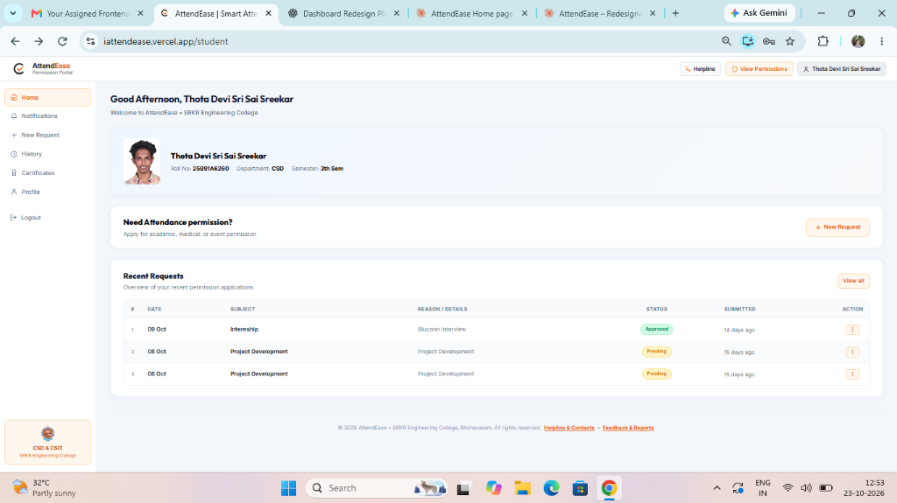
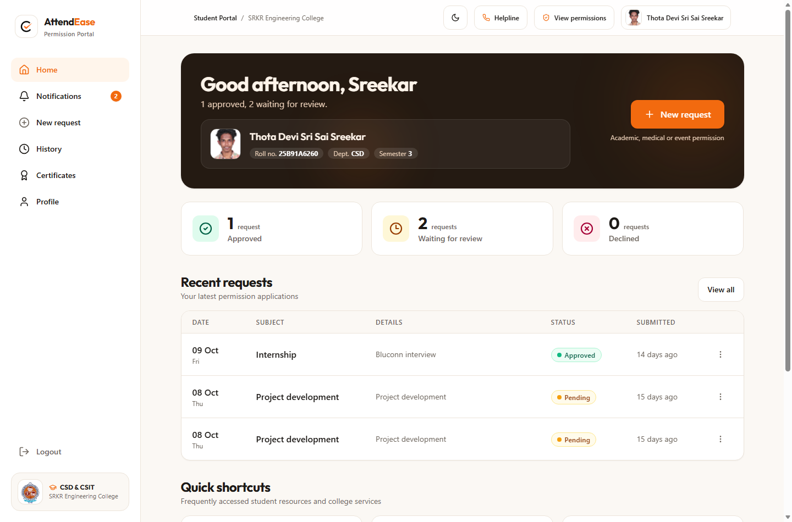
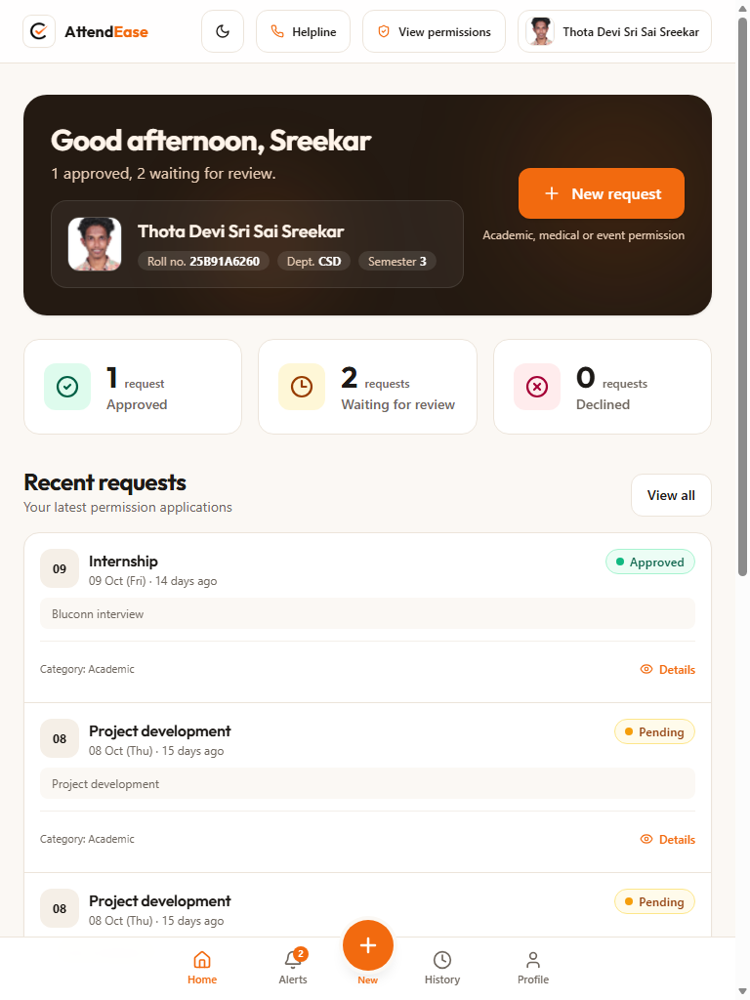
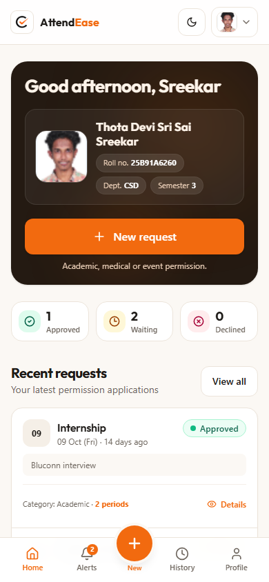
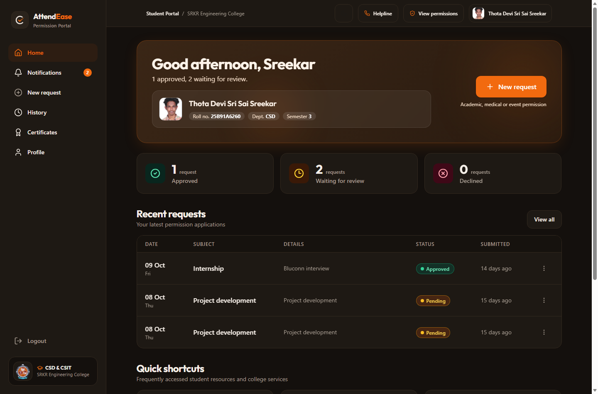
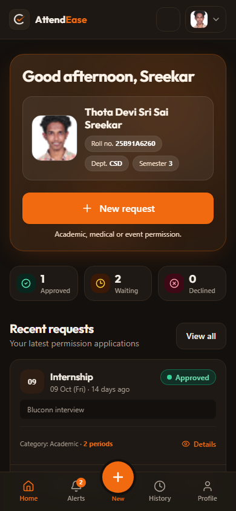
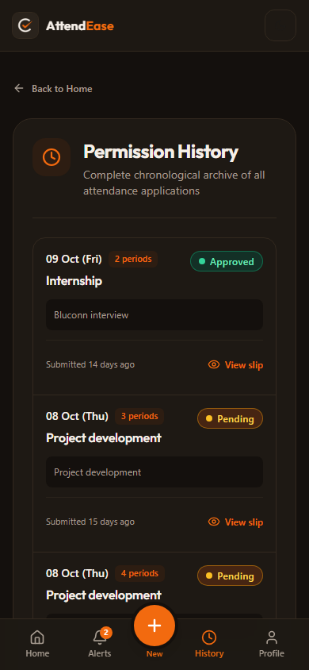
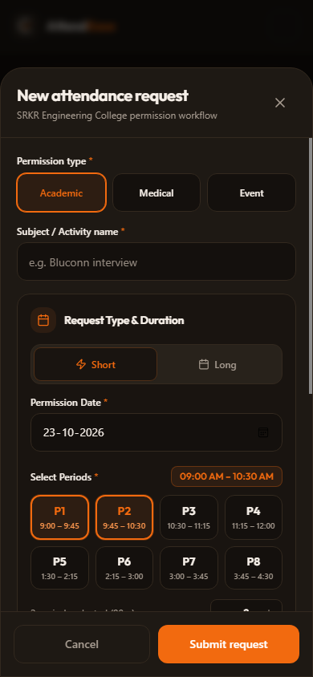

# AttendEase — Student Permission Portal Redesign

Live demo: <ADD VERCEL URL> | Repository: <ADD GITHUB URL>

**SRKR Engineering College (CSD & CSIT)**  
A modern, accessible, and responsive student attendance-permission portal redesign. Built with **React 18**, **Vite**, **Tailwind CSS v4**, and **Lucide React**.

---

## Table of Contents
1. [Project Overview](#project-overview)
2. [Tech Stack](#tech-stack)
3. [Quick Start & Local Setup](#quick-start--local-setup)
4. [Deploying to Vercel](#deploying-to-vercel)
5. [Redesign Documentation](#redesign-documentation)
   - [Audit: Problems in the Original Interface](#audit-problems-in-the-original-interface)
   - [Key Improvements & Rationale](#key-improvements--rationale)
   - [Design Decisions & System](#design-decisions--system)
   - [Accessibility & Inclusive Design](#accessibility--inclusive-design)
   - [Responsive Behavior Matrix](#responsive-behavior-matrix)
6. [Limitations](#limitations)
7. [Component Architecture](#component-architecture)
8. [Visual Comparison (Before vs. After)](#visual-comparison-before-vs-after)

---

## Project Overview

AttendEase is the digital clearance and attendance permission portal used by students and faculty at **SRKR Engineering College, Bhimavaram** for the Department of Computer Science and Design (CSD) and CSIT.

Students use the portal to apply for attendance permissions (internships, academic hackathons, medical leave, and college events), review live application statuses, download clearance certificates, and look up faculty contacts.

This redesign addresses critical UX hierarchy flaws, typography inconsistencies, layout redundancies, and mobile omissions found in the legacy interface—transforming the student dashboard into a high-utility, visually engaging, and accessible web application.

---

## Tech Stack

- **Runtime & Build**: [Vite](https://vite.dev/) 6 + [React](https://react.dev/) 18 (JavaScript, JSX)
- **Styling**: [Tailwind CSS v4](https://tailwindcss.com/) using the native `@tailwindcss/vite` plugin
- **Icons**: [Lucide React](https://lucide.dev/)
- **Routing**: [React Router](https://reactrouter.com/) v6 (client-side routing for seamless shell navigation)
- **Data Layer**: Pure client-side state with initial mock records in `src/data/mock.js` (no backend dependencies required)

---

## Quick Start & Local Setup

### Prerequisites
- Node.js `v18.0.0` or later (tested on Node.js `v24.x`)
- npm `v9.x` or later

### Installation

```bash
# Clone or navigate to the project directory
cd Attendanceease

# Install dependencies
npm install

# Start development server
npm run dev
```

The application will be live at `http://localhost:5173/`.

### Production Build

```bash
# Build production bundle to /dist
npm run build

# Preview production build locally
npm run preview
```

---

## Deploying to Vercel

The project is structured with zero-configuration build settings for Vercel.

### Option A: Via Vercel Web Dashboard (Recommended)
1. Push your repository to GitHub, GitLab, or Bitbucket.
2. Sign in to [Vercel](https://vercel.com/) and click **"Add New Project"**.
3. Import your repository.
4. Vercel automatically detects **Vite**:
   - **Framework Preset**: `Vite`
   - **Build Command**: `npm run build`
   - **Output Directory**: `dist`
5. Click **"Deploy"**. Your portal will be deployed with a live `.vercel.app` URL.

### Option B: Via Vercel CLI
```bash
# Install Vercel CLI globally if not already installed
npm install -g vercel

# Deploy directly from workspace root
vercel
```

---

## Redesign Documentation

### Audit: Problems in the Original Interface

A comprehensive evaluation of the original student interface (`iattendease.vercel.app/student`) revealed eight distinct usability and visual design issues:

| # | Flaw Identified | Impact on Student Experience |
|---|----------------|------------------------------|
| 1 | **Primary action buried in a low-contrast card** | "Need Attendance permission?" was presented as an expansive, low-priority outline banner rather than a prominent primary call to action. |
| 2 | **Equal-weight cards and weak hierarchy** | All dashboard modules shared identical visual weight with white boxes and light borders, leaving no natural focal anchor. |
| 3 | **7-column table with redundant "#" column** | The desktop table included an ordinal index column (`#`) that provided zero domain value while wasting horizontal space. |
| 4 | **Absence of a status summary** | Students had no instant overview of how many requests were approved, pending, or declined without scanning row-by-row. |
| 5 | **Status communicated by tiny badges** | Status indicators lacked sufficient size, semantic dot anchors, and clear text labels, impairing readability for low-vision users. |
| 6 | **Shortcuts hidden or omitted** | Essential tasks (downloading approval slips, checking clearance rosters, reaching department HOD) had no quick access. |
| 7 | **Academic record typo ("3th Sem")** | The identity card showed the grammatically incorrect string `"3th Sem"`, undermining credibility. |
| 8 | **Mobile layout omitted critical context** | The original mobile view omitted the request details text, the date weekday, and the shortcuts, and offered no status summary. |

---

### Key Improvements & Rationale

#### 1. Premium Focal Hero Card (`#241a12`)
- **Change**: Replaced the plain greeting with a rich, dark brown (`#241a12`, `radius: 24px`) hero container featuring subtle ambient lighting and a gentle entrance animation.
- **Rationale**: Creates an immediate visual anchor. It incorporates a time-aware greeting (*"Good morning/afternoon/evening, Sreekar"*), dynamic data-derived summary line (*"1 approved, 2 waiting for review"*), verified student identity badges, and the **sole filled orange primary button** on the entire page.

#### 2. Live Metric Summary Tiles
- **Change**: Added three interactive stat tiles: **Approved** (emerald), **Waiting for review** (amber), and **Declined** (rose).
- **Rationale**: Students immediately know their clearance status upon logging in. Counts are dynamically derived from the `requests` data array. Tiles also double as instant filter controls.

#### 3. Streamlined Request List & Adaptive Mobile Cards
- **Change**: Removed the useless `#` column. Formatted columns cleanly: **Date (with weekday pill)**, **Subject**, **Details**, **Status Pill**, **Submitted Age**, and **Row Actions menu**.
- **Rationale**: On screens `< 900px`, rows seamlessly morph into structured touch-friendly cards with date badges, reason details, category, and status indicators.

#### 4. Accessible Status Pills (Color + Dot + Text)
- **Change**: Every status badge uses a three-tier visual signal: high-contrast background tint, a solid colored dot indicator, and unambiguous semantic text.
- **Rationale**: Complies with WCAG 1.4.1 (Use of Color), guaranteeing that color is never the sole medium for conveying state.

#### 5. Department Quick Shortcuts
- **Change**: Dedicated 3-card shortcut cluster: **"Download a certificate"**, **"Check approved permissions"**, and **"Contact your HOD"**.
- **Rationale**: Surfaces high-frequency actions previously buried in secondary menus directly into the main student workflow.

#### 6. Grammatical Polish & Plain Copy
- **Change**: Fixed the `"3th Sem"` typo to clean, professional `"Semester 3"`. Standardized plain-language labels (*"New request"*).

#### 7. Number of Periods Stepper & Duration Tracking
- **Change**: Added a required "Number of periods" field (stepper with minus, number, plus; validated 1 to 8 whole periods) to the new request form, displayed across request rows, mobile cards, and history letter slips.
- **Rationale**: Allows faculty and students to specify the exact class period clearance required rather than ambiguous whole-day absences.

#### 8. Mobile Responsiveness & Layout Hardening
- **Change**: Restructured the mobile profile card with CSS Grid (`72px minmax(0, 1fr)`) preventing photo/name overlaps, uncapped hero greeting line height (26px font) to avoid clipping, compacted stat tiles into 3 columns on ≥360px (single row ≤64px on 320px), redesigned the request modal as a bottom sheet (max-height 90vh, sticky footer), and added `calc(104px + env(safe-area-inset-bottom))` padding preventing bottom nav clipping.
- **Rationale**: Eliminates text truncation, eliminates horizontal scrolling (320px to 430px), and ensures full tap target accessibility across all small screens.

---

### Design Decisions & System

#### Color Palette
- **Brand Orange Accent**: `#f26a0f` — Preserves the AttendEase identity while meeting contrast thresholds.
- **Hero Canvas**: `#241a12` in light mode; lighter warm-brown gradient (`#3a2616` to `#2a1b10`) with a 1px orange-tinted border and soft orange glow in dark mode.
- **Light Surfaces**: Warm off-white canvas `#fbf8f4`, white cards `#ffffff`, subtle borders `#ece4da`.
- **Status Tones**:
  - Approved: Emerald (`#10b981` dot, `bg-emerald-50`, `text-emerald-700`)
  - Pending: Amber (`#f59e0b` dot, `bg-amber-50`, `text-amber-800`)
  - Declined: Rose/Red (`#f43f5e` dot, `bg-rose-50`, `text-rose-700`)

#### Typography
- **Headings**: `Outfit` (weights 500, 600, 700, 800) from Google Fonts for crisp, modern editorial authority.
- **Body**: `Figtree` (weights 400, 500, 600) for high legibility at compact sizes.

#### Dark Mode Architecture (Tailwind CSS v4)
- **Tailwind v4 Variant**: Configured `@custom-variant dark (&:where(.dark, .dark *));` in `src/index.css` so that `dark:` utility classes respond to the `.dark` class on `<html>` rather than relying exclusively on system preference.
- **Zero-Flash Hydration**: Embedded a tiny inline script in `<head>` in `index.html` to evaluate `localStorage.getItem('theme')` and `window.matchMedia('(prefers-color-scheme: dark)')` before React mounts.
- **Theme Variables & Tokens**:
  - Background Canvas: Light `#fbf8f4` ➔ Dark `#14100d`
  - Surface Cards: Light `#ffffff` ➔ Dark `#1e1914`
  - Subtle Borders: Light `#ece4da` ➔ Dark `#33291f`
  - Primary Text: Light `#2b221a` ➔ Dark `#f6efe8`
  - Muted Text: Light `#827467` ➔ Dark `#a79c91`
  - Accent: High-visibility orange `#f26a0f`
  - Hero Card (Dark Mode): Styled with a lighter warm-brown gradient (`#3a2616` to `#2a1b10`), a 1px orange-tinted border (`rgba(242, 106, 15, 0.28)`), and a soft orange glow (`box-shadow: 0 10px 40px -12px rgba(242, 106, 15, 0.25)`) in dark mode only to lift cleanly off the background.
  - Status Badges: WCAG AA compliant contrast colors in both light and dark modes
- **Accessible Toggle Button**: Top bar toggles between `Moon` (light mode) and `Sun` (dark mode) with dynamic `aria-label="Switch to dark mode"` / `"Switch to light mode"`.

#### Motion & Micro-interactions
- Hero card entrance uses a single subtle 350ms slide-and-fade (`heroEntrance`).
- Respects `prefers-reduced-motion: reduce` by zeroing transition durations and animations.

---

### Accessibility & Inclusive Design

- **Semantic Landmarks**: Proper `<header>`, `<aside>`, `<nav aria-label="...">`, `<main id="main-content">`, `<section aria-labelledby="...">`, and `<footer>`.
- **Keyboard Navigation**: Explicit `:focus-visible` ring styles (`outline: 2px solid #f26a0f`, `offset: 2px`).
- **Touch Targets**: All buttons, links, and mobile bottom nav items maintain a minimum touch target of **44 × 44px**.
- **Safe Area Insets**: Bottom navigation and main content container respect iOS/Android safe area insets via `env(safe-area-inset-bottom, 0px)`.

---

### Responsive Behavior Matrix

| Viewport Width | Navigation Shell | Layout Strategy | Table / List Behavior |
|----------------|-----------------|-----------------|----------------------|
| **Desktop (>= 900px)** | Fixed left sidebar (256px) + sticky top bar | Two-column persistent app shell with 256px offset | Full 6-column grid list with row action menu |
| **Tablet (768px - 899px)** | Top bar + Fixed bottom bar | Single-column centered container (max 1024px) | Adaptive cards displaying date, reason, category, and status |
| **Mobile (< 768px down to 360px)** | Fixed bottom nav with raised circular orange `+` button | Single-column fluid stack, zero horizontal scroll | Stacked touch-friendly cards with inline details |

---

## Limitations

- The redesign was done without access to the original source code, based on the live site.
- Data is mocked in `src/data/mock.js`.
- Periods are front-end only and stored in component/mock state, not saved to a real backend.
- The student photo loads from `public/student.jpg` with an initials fallback.

---

## Component Architecture

```
src/
├── components/
│   ├── BottomNav.jsx         # Mobile fixed bottom bar with elevated orange '+' action
│   ├── Footer.jsx            # Copyright, institution details, and policy links
│   ├── Hero.jsx              # Time-aware greeting, student chips, primary CTA
│   ├── NewRequestModal.jsx   # Bottom sheet dialog form with periods stepper & validation
│   ├── RequestList.jsx       # Responsive table & cards with periods, status pills, and actions
│   ├── Shortcuts.jsx         # 3 quick-action cards for certificates, roster, HOD
│   ├── Sidebar.jsx           # Fixed desktop sidebar with badges, logout, SRKR card
│   ├── StatTile.jsx          # Compact metric cards for Approved, Waiting, Declined
│   ├── StatusPill.jsx        # Standardized color + dot + text status pill
│   └── TopBar.jsx            # Desktop context breadcrumb, helpline, profile, theme toggle
├── data/
│   └── mock.js               # Initial student identity and request records with periods
├── pages/
│   ├── Home.jsx              # Main student dashboard orchestrator
│   └── PlaceholderPage.jsx   # Route targets for Notifications, History, Certificates, etc.
├── App.jsx                   # Root layout, theme sync, routing, and request state
├── index.css                 # Design tokens, typography, dark mode, media utilities
└── main.jsx                  # React 18 createRoot & BrowserRouter
```

---

## Visual Comparison (Before vs. After)

### Before (Legacy Portal)

*Figure 1: Legacy portal showing buried primary action, equal-weight white cards, 7-column table with "#" column, and typo.*

---

### After: Desktop Redesign (1440px)

*Figure 2: Modern AttendEase student home page featuring the dark hero card, live stat summary tiles, streamlined requests list, and shortcuts.*

---

### After: Tablet Redesign (768px)

*Figure 3: Clean transition at 768px width showing bottom navigation, adaptive cards, and centered layout.*

---

### After: Mobile Redesign (390px - Light Mode)

*Figure 4: Mobile viewport showing unclipped hero greeting, grid-aligned profile card (72x88px photo, no overlap), 3-column compact stat tiles, and bottom nav with raised "+" button.*

---

### After: Desktop Redesign (1440px - Dark Mode)

*Figure 5: Dark mode at 1440px desktop showing surface `#1e1914`, border `#33291f`, canvas `#14100d`, Sun toggle icon, and high-contrast WCAG AA status badges.*

---

### After: Mobile Redesign (390px - Dark Mode)

*Figure 6: Dark mode on mobile showing floating hero card with faint orange border and glow, non-overlapping identity grid, compact 3-column stat tiles, and bottom nav.*

---

### After: Mobile Permission History (390px - Dark Mode)

*Figure 7: Permission History below 768px showing stacked cards with date, periods badge, subject, details, status pill, and actions without horizontal overflow.*

---

### After: Mobile New Request Bottom Sheet (390px - Dark Mode)

*Figure 8: New permission request bottom sheet featuring the 1-8 periods stepper, 48px touch inputs, and sticky action buttons.*


